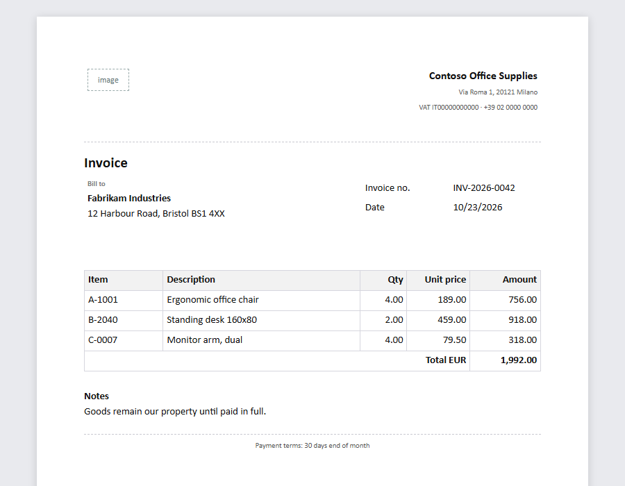
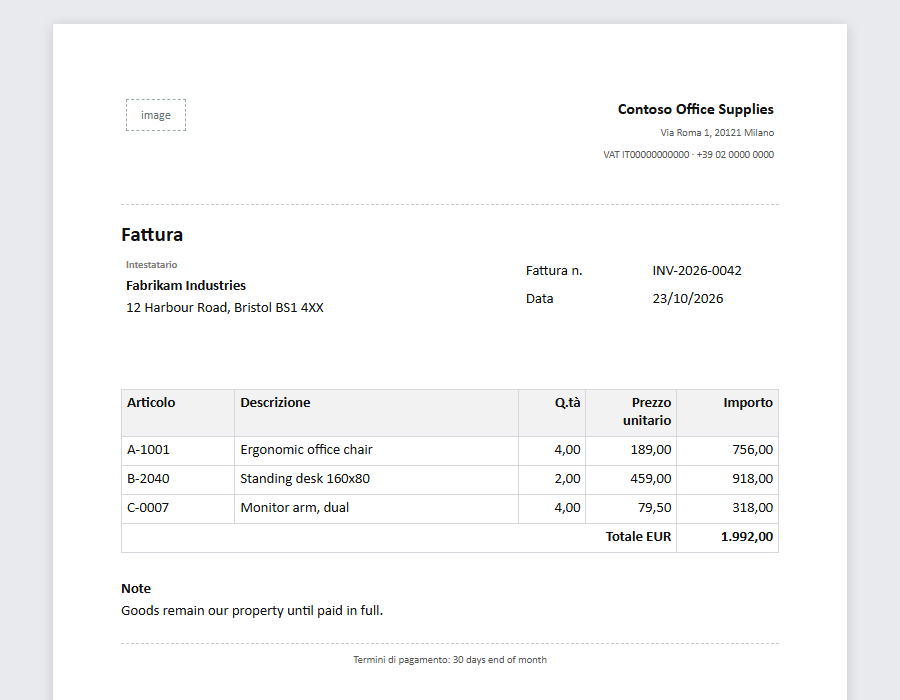
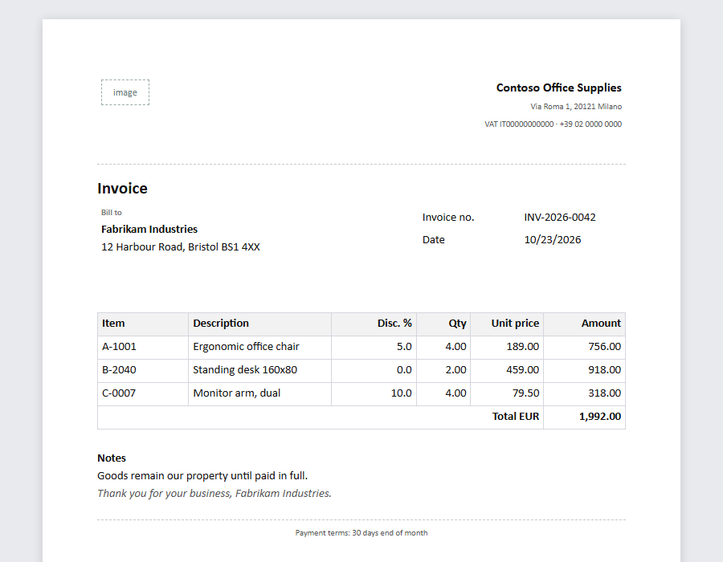
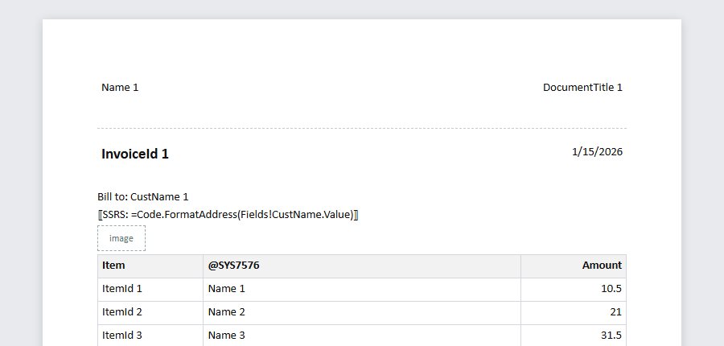
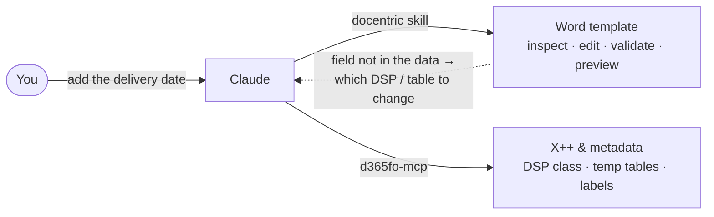

<div align="center">

# docentric-skill

**Teach Claude to design Docentric reports for Dynamics 365 Finance & Operations.**

A [Claude skill](https://docs.anthropic.com/en/docs/agents-and-tools/agent-skills/overview) that reads, validates,
previews, edits and creates Docentric AX templates — and converts SSRS reports to Docentric — from a plain request.

[](https://github.com/DavideWasTaken/docentric-skill/actions/workflows/ci.yml)


[](LICENSE)




<sub>A template built from <a href="examples/sales-invoice.yaml">a short layout spec</a>, previewed in English and Italian with its sample data.</sub>

</div>

---

> *"In the purchase order template, add the vendor's item number after the item code, show the notes only when
> they're filled in, and let me see it."*

With this skill Claude finds the elements in the template, checks the fields exist in the report data, makes the
change, validates every binding and **looks at a rendered preview** before handing the file back. When a field is
not in the data yet, it says so — and explains the X++ / DDSP change instead of inventing a binding.

## Why a skill, and not just "here's my .docx"

Claude can unzip a `.docx` and edit XML on its own. A Docentric template is a Word document plus a hidden registry:
content controls tagged `<projectId>-<elementId>`, an element tree, XSD schemas and sample data from the DDSP,
template labels mixed with cached D365 labels. Hand edits easily produce files that open in Word and break in the
Docentric Designer or at print time — a table row whose cells no longer match the grid, an element missing from the
registry, a binding to a field that does not exist.

The skill gives Claude the format knowledge **and a tested tool** (one JavaScript file, 119 tests behind it).

**We measured it.** Four requests — add a column, add a field that does not exist, create a delivery note, and add a
column to a real 14-column customer purchase order (not published) — each run by fresh Claude agents with and without
the skill, outputs checked with the validator and a structural check:

| | With the skill | Without |
|---|---|---|
| Correct, valid templates | 4 / 4 | 4 / 4 |
| Average time | **86 s** | 161 s |
| Average tokens | **85 k** | 102 k |

The honest reading: a frontier model *can* do these edits on its own — it reverse-engineers the format and writes a
throwaway script for every request. With the skill it is about **twice as fast and cheaper**, and the work is
**repeatable**: the same tested code every time instead of a new script, validation with did-you-mean suggestions, a
real multi-page preview, and the parts nobody improvises — SSRS conversion and the D365 field/DDSP workflow. The test
cases live in [`skills/docentric/evals`](skills/docentric/evals).

## What Claude can do with it

| | |
|---|---|
| 🔍 **Inspect** | Report, DSP class, languages, data sources, every element with its binding and data context, the schema's field tree. |
| ✅ **Validate** | 19 offline rules: bindings vs the schema with did-you-mean, orphaned controls, missing/untranslated labels, variables, provisional schemas. |
| 👁️ **Preview** | Fills the template with its sample data — lists repeat, conditions apply, totals and variables compute, labels per language — and renders PNG/PDF/HTML. Claude looks at it. |
| ✏️ **Edit** | Insert blocks, add a table column, change bindings, show/hide on conditions, remove, labels and languages, or turn `{{placeholders}}` typed in Word into real fields. Always to a new file; refuses to save new errors. |
| 🧱 **Create** | New templates from a layout spec: headings, side-by-side blocks, data tables with totals, conditional sections, images, header/footer, multilingual labels, your corporate styles. |
| 🔁 **Convert SSRS** | AxReport → layout spec + template: Tablix → data tables, `=Fields!X.Value` → `{{@X}}`, `First()`, `Sum()`, `Format()`, parameters, labels, images. What it cannot translate is marked and listed. |

<table>
<tr>
<td width="50%"><br><sub><b>Edit</b>: a "Disc. %" column after the description and a closing line after the notes — <a href="examples/SalesInvoice.edit.yaml">3 operations</a>.</sub></td>
<td width="50%"><br><sub><b>Convert</b>: <a href="examples/ssrs/ConInvoice.AxReport.xml">an SSRS report</a> turned into a Docentric template.</sub></td>
</tr>
</table>

## Install

The skill runs a small Node.js script, so the machine needs **Node.js 18+** (`node --version`; on Windows
`winget install OpenJS.NodeJS.LTS`). Optional, for PDF previews: Microsoft Word (Windows) or LibreOffice; for PNG
previews: Edge or Chrome. Without them previews are HTML.

**Claude Code** — as a plugin:

```
/plugin marketplace add DavideWasTaken/docentric-skill
/plugin install docentric@docentric-skill
```

or copy [`skills/docentric`](skills/docentric) into `~/.claude/skills/` (all projects) or `.claude/skills/` (one
project).

**claude.ai / Claude Desktop** — download `docentric-skill.zip` from the
[latest release](https://github.com/DavideWasTaken/docentric-skill/releases/latest), then *Settings → Capabilities →
Skills → Upload skill* (code execution must be enabled).

Then just ask — no command to remember:

- *"Validate PurchPurchaseOrder.docx and show me a preview in Italian."*
- *"Add a column with the discount percentage after the description in the invoice lines."*
- *"Why does the delivery date print empty?"*
- *"Create a delivery note template from the same data as SalesInvoice.docx."*
- *"Convert the SSRS report SalesInvoice to Docentric."*

Trying it on a clean machine: [docs/TESTING_FROM_SCRATCH.md](docs/TESTING_FROM_SCRATCH.md).

## Works with d365fo-mcp

Templates only know the data their DDSP describes. Everything upstream is X++: the DSP class, the report's temp
tables, the labels. With [**d365fo-mcp-server**](https://github.com/dynamics365ninja/d365fo-mcp-server) connected,
Claude uses both: this skill for the Word template, d365fo-mcp for the code that feeds it.



## The tool on its own

Everything the skill does is also a command line, handy in CI or for reviewing templates in git:

```bash
node skills/docentric/scripts/docentric.mjs validate template.docx        # exit code 1 on errors
node skills/docentric/scripts/docentric.mjs preview template.docx --formats pdf,png --lang it
node skills/docentric/scripts/docentric.mjs edit template.docx ops.yaml --out edited.docx
node skills/docentric/scripts/docentric.mjs dump template.docx            # stable text for git diff
```

Templates are binary, but git can diff them as text:

```bash
git config diff.docentric.textconv "node /path/to/skills/docentric/scripts/docentric.mjs dump"
echo "*.docx diff=docentric" >> .gitattributes
```

## Honest limits

- **Previews are approximations** built from the sample data stored in the template; unknown expression functions
  show as `⟨name()⟩`. Docentric's own preview in D365 or the Designer is the final word.
- **Open generated templates once in the Docentric Designer** before production. Word opens them; the Designer
  round-trip is what we ask you to report ([issue template](.github/ISSUE_TEMPLATE)).
- **Schemas declared in a spec or derived from SSRS are provisional** until the real DDSP is loaded.
- Only `Sum` is generated for totals (the only aggregate code confirmed on real templates). SSRS group rows,
  sub-reports, charts and custom code are listed, not converted.

## Privacy

Real templates embed sample data from D365 — names, addresses, VAT numbers. The tool runs locally, makes no network
calls and only writes new files. Everything in this repository is synthetic; please keep it that way
([CONTRIBUTING.md](CONTRIBUTING.md)).

## Repository layout

```
skills/docentric/            the skill: SKILL.md, references/, scripts/docentric.mjs (generated), evals/
.claude-plugin/              Claude Code plugin + marketplace manifests
src/                         the TypeScript sources of the tool
tests/                       119 tests on synthetic templates
examples/                    a layout spec, a generated template, edit operations, an SSRS report
docs/                        testing from scratch, screenshots
```

## Development

```bash
npm ci
npm run typecheck && npm run lint && npm run format:check && npm run test:run
npm run build       # regenerate skills/docentric/scripts/docentric.mjs (CI checks it is up to date)
npm run package     # dist/docentric-skill.zip for claude.ai
npm run examples    # regenerate examples/ (add -- --images for the README screenshots)
```

## License

MIT — see [LICENSE](LICENSE). Docentric is a product of Docentric d.o.o.; Dynamics 365 is a Microsoft product. This
project is independent and not affiliated with or endorsed by either.
